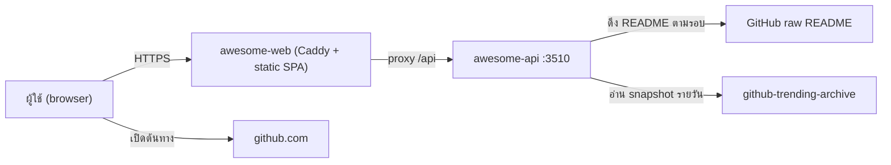
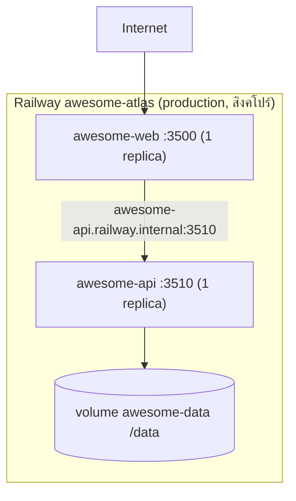

# Awesome Atlas Web — สถาปัตยกรรม

## Context diagram

## Components/containers

| Component | ที่อยู่ | หน้าที่ |
|---|---|---|
| SPA | `src/App.tsx`, `src/CatalogPanels.tsx` | UI ค้นหา รายละเอียด เปรียบเทียบ อันดับ |
| State helpers | `src/state.ts` | บุ๊กมาร์ก (validate repo id, จำกัด 200) |
| Types | `src/types.ts` | รูปข้อมูลจาก contract `awesome.v1` |
| Dev proxy | `vite.config.ts` | proxy `/api` ไป `AWESOME_API_ORIGIN` (ค่าเริ่มต้น `http://127.0.0.1:3510`) |
| Production server | `Caddyfile`, `Dockerfile` | เสิร์ฟ `dist/` ด้วย Caddy, `/health`, proxy `/api/*` |

API ที่เว็บเรียกผ่าน `getJSON` → `/api/v1/<path>`: `categories`, `sources`, `status`, `daily/sources`
และ endpoint รายการ/เปรียบเทียบ/อันดับรายวันที่ประกอบตามมุมมอง (ดู contract ของ `awesome-api`)

## Tech stack

- React 19, TypeScript 5.9, Vite 8, lucide-react, fontsource (DM Sans, Noto Sans Thai)
- ทดสอบ: Vitest 5 (`tests/state.test.ts`), Playwright (`tests/browser/catalog.spec.ts`, `tests/browser/catalog-analysis.spec.ts`)
- Runtime production: `caddy:2-alpine` รันเป็น UID 10001; build stage `node:22-alpine`

## Data stores

| ที่เก็บ | เจ้าของ | ข้อมูล |
|---|---|---|
| `localStorage` ของ browser | ผู้ใช้ | บุ๊กมาร์ก (`awesome-atlas-saved-v1`), ธีม (`awesome-atlas-theme`) |
| volume `/data` ของ `awesome-api` | `awesome-api` | `catalog.sqlite3` (projection), `lake/` (landing, Bronze Parquet, manifests) |

เว็บไม่มีฐานข้อมูลของตัวเอง data owner ตาม registry คือ `awesome-public-github-lake`

## Integrations

- `awesome-api` ผ่าน contract `awesome.v1` บน origin เดียวกัน (ไม่ฝัง backend address ใน bundle และไม่เปิด CORS กว้าง)
- แหล่งข้อมูลภายนอก (เข้าถึงผ่าน API เท่านั้น): GitHub raw README, `antonkomarev/github-trending-archive`

## Deployment topology

Build จาก repository root ด้วย `apps/awesome-web/Dockerfile` และ `Dockerfile.dockerignore` แบบ allowlist
source ของ Railway คือ repo แยก `bookchaowalit/awesome-atlas` branch `main` ตาม deployment README

## ADR สำคัญ

| ID | การตัดสินใจ | เหตุผล |
|---|---|---|
| ADR-01 | แยกเว็บ (static) กับ API เป็นสอง service | deploy อิสระ เว็บไม่แตะข้อมูล |
| ADR-02 | proxy `/api` บน origin เดียวกัน | ไม่ต้องเปิด CORS หรือส่ง credentials ให้ browser |
| ADR-03 | บุ๊กมาร์กเก็บใน browser | ไม่ต้องมีบัญชีหรือข้อมูลส่วนบุคคลฝั่งเซิร์ฟเวอร์ |
| ADR-04 | ไม่ใช้ `railway.toml` ตั้งค่าผ่าน Railway connector | ตาม deployment README |

## การอนุมัติ

| บทบาท | สถานะ | วันที่ | ลงนาม |
|---|---|---|---|
| Solution Architect | รอพิจารณา | — | ________ |

## แหล่งข้อมูล

- `apps/awesome-web/vite.config.ts`, `apps/awesome-web/Caddyfile`, `apps/awesome-web/Dockerfile`, `apps/awesome-web/package.json`
- `apps/awesome-web/src/App.tsx`, `apps/awesome-web/src/state.ts`
- `services/awesome-api/deployment/README.md`
- `repository-catalog/registries/runtime-boundaries.yaml`
